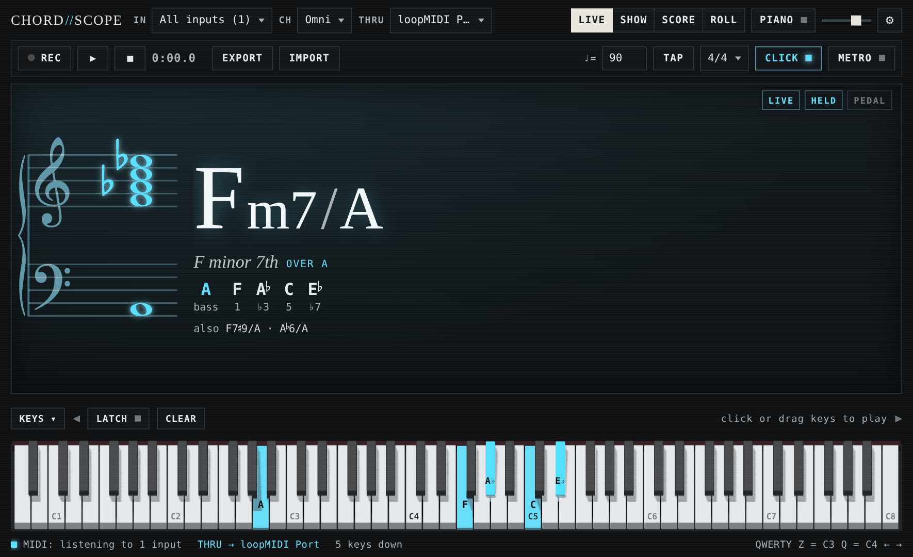
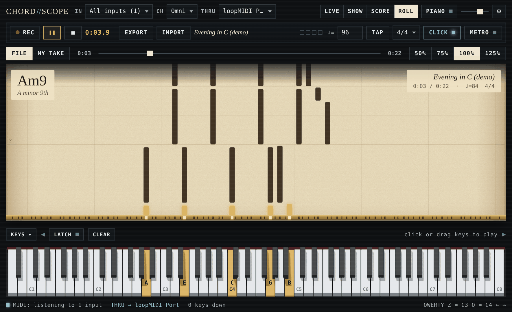
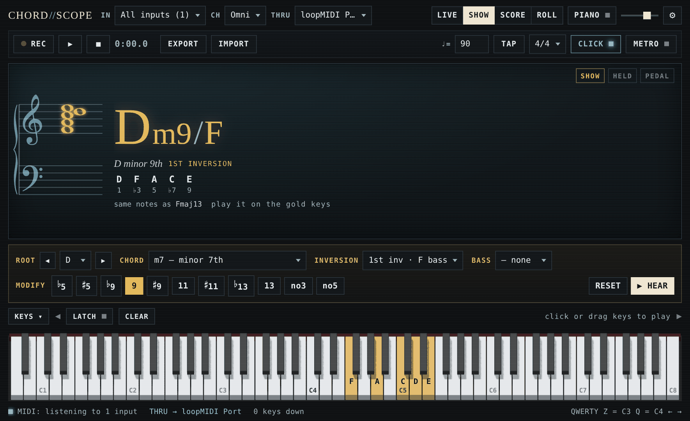
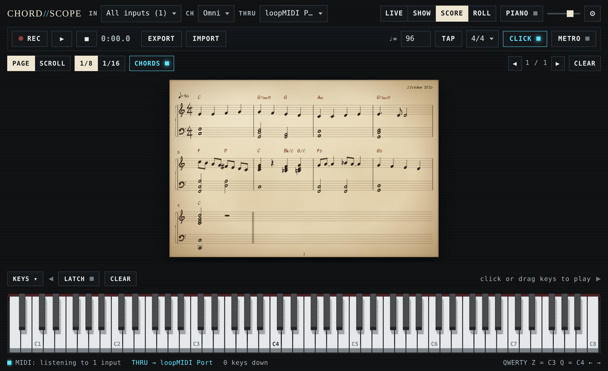

# CHORD//SCOPE

**Live chord names, a grand staff, a chord builder, a real-time score and a player piano for your MIDI keyboard, in a single HTML file.**

Plug in a keyboard, open the page in Edge or Chrome and play. CHORD//SCOPE:

- names what you hold, from *C minor* up to *C13♯9* or *F minor 7th over A*, and writes it on a grand staff
- lights up any chord on a 3D keyboard so you can learn it
- writes your playing onto manuscript paper as you go
- records sessions and exports them as **MusicXML**, **MIDI** or **PDF**
- opens MIDI and MusicXML files and plays them like an old player piano, with the keys going down by themselves

It has a built-in sampled grand piano and a metronome, runs offline and installs nothing.

**[▶ Open CHORD//SCOPE in your browser](https://scottiefox.github.io/chordscope/)**



## Features

- **LIVE**: names whatever you hold, up to 10 notes; more than 10 are counted, not named. It shows:
  - the chord symbol and its full name
  - the inversion or bass note
  - each note's role (bass, 1, ♭3, 5, ♭7, 9…)
  - other possible names for the same notes
  - the notes on a grand staff with correct sharps and flats, with 8va/15ma marks for very high or low notes
- **SHOW**: build a chord from menus and see it on the keys, in gold, in its simplest voicing around middle C. Play it back and the keys turn mint when you match it. You choose:
  - a root and a chord type: triads, sixths, sevenths, add chords, 9/11/13 chords or altered dominants
  - modifiers: ♭5 ♯5 ♭9 9 ♯9 11 ♯11 ♭13 13 no3 no5
  - an inversion and a bass note
- **SCORE**: writes what you play onto parchment manuscript in real time, with chord symbols, ties, rests and the split between your hands. **PAGE** fills 3 systems of 4 bars and turns the page; **SCROLL** keeps one large system moving left as you play.
- **Metronome**: tempo, TAP tempo, 4/4, 3/4 or 2/4, beat lights, and a click you can switch off. While it runs, the score's bar lines follow it.
- **Record and export**: **● REC** records a session (one bar of count-in with the metronome) and **■** stops it. **EXPORT** saves it as:
  - **MusicXML**, the standard format for sheet music
  - **MIDI**, as you played it or snapped to the grid
  - a **PDF**
- **Import and play (ROLL)**: open a **MIDI** file (`.mid`) or a **MusicXML** score (`.musicxml`, `.xml`, `.mxl`). **▶** plays it on the 3D keyboard like a player piano while a paper roll scrolls down into the keys. You see chord names as it plays, can slow it down to practise, and the keys you play along with turn mint when they're right.
- **3D keyboard** (three.js): 88, 76, 61 or 49 keys. Click or drag to play (lower on a key = louder), use LATCH to build chords one key at a time, or play from your computer keyboard.
- **Grand piano**: built-in Salamander Grand Piano samples with velocity, sustain pedal and reverb.
- **MIDI THRU**: sends your keyboard on to another MIDI port, so FL Studio or any other DAW can use it at the same time. The on-screen keys and the player piano go through too.
- **One file, no install**: everything (code, fonts, piano samples) is inside `index.html`. Nothing is sent anywhere, and settings are saved in your browser.

| ROLL: player piano | SHOW: build a chord and learn it |
| --- | --- |
|  |  |

## Getting started

### In your browser

Open **https://scottiefox.github.io/chordscope/** in **Microsoft Edge** or **Google Chrome**. Allow MIDI access when asked, then choose your keyboard under **IN** (or leave it on *All inputs*).

### On your PC, offline, in its own window (Windows)

1. Download the project: **Code → Download ZIP** on GitHub, then unzip it anywhere.
2. Double-click **`Launch ChordScope.cmd`**.

The launcher opens `index.html` in an Edge (or Chrome) app window, with no tabs or address bar. It uses its own browser profile, so your MIDI permission and window size are remembered, and the piano can play without a click first. You can also just double-click `index.html` to open it in your normal browser.

### Browser support

| Browser | Works? |
| --- | --- |
| Edge, Chrome and other Chromium browsers (desktop) | Everything |
| Firefox | Use the web link: Firefox asks you to add a small site-permission add-on before it allows MIDI |
| Safari | No Web MIDI. The on-screen keyboard, computer keys, SHOW, the player piano and the piano still work |

## Using it with FL Studio (or another DAW)

On Windows, a MIDI keyboard can usually be opened by only one program at a time. If FL Studio already has yours, CHORD//SCOPE marks it as **busy**, retries every few seconds, and connects as soon as it's free. To use both programs at once, put CHORD//SCOPE in the middle:

1. Install **[loopMIDI](https://www.tobias-erichsen.de/software/loopmidi.html)** (free) and create a port, for example *loopMIDI Port*.
2. In CHORD//SCOPE, set **IN** to your keyboard and **THRU** to *loopMIDI Port*.
3. In FL Studio, open **Options → MIDI settings**. Turn off your keyboard as an input and turn on *loopMIDI Port* instead.
4. Start CHORD//SCOPE before FL Studio, or turn the keyboard off in FL Studio first, so that CHORD//SCOPE can open it.

Everything you play now goes on to FL Studio, including the sustain pedal and controllers. Notes from the on-screen keyboard, your computer keys and the player piano go too, so an imported file can drive an FL Studio instrument. CHORD//SCOPE never listens to its own THRU port, so it can't create a feedback loop.

> Newer Windows 11 builds with **Windows MIDI Services** let several programs share one MIDI device. On those, you may not need loopMIDI at all.

## How to use it

### LIVE

Play, and the chord is named while you hold it. When you let go, the last chord stays on screen, dimmed (turn this off with *Keep last chord* in the settings). Click the chord name or the staff to hear it on the built-in piano. The settings can also make the sustain pedal hold the chord, and choose how notes are spelled: automatic, always ♯ or always ♭.

### SHOW

Choose **ROOT** (◀ ▶ step by a semitone), **CHORD**, **INVERSION** and **BASS**, and toggle modifiers under **MODIFY**. The notes light up in gold. **▶ HEAR** plays the chord and **RESET** clears the modifiers, inversion and bass. When you play the chord, the keys turn mint and the display says ✓ MATCH. If it doesn't match, it tells you which notes are missing or extra, or which note belongs in the bass.

### SCORE



- Notes snap to the grid (⅛ or 1/16) at the metronome's tempo.
- **With the metronome running**, bar lines follow its clicks, so a note on beat 3 is written on beat 3.
- **Without it**, your first note is beat 1 of a new bar. After a silent bar the phrase closes with a double bar line, and your next note starts a fresh bar.
- **CHORDS** writes chord symbols above the staff, and **CLEAR** starts a new score.
- **PAGE** shows 3 rows of 4 bars and turns the page when it's full (◀ ▶ to look back). **SCROLL** shows one large row that scrolls left as you play.
- Notes are split between the hands by where they fall around middle C. Each hand is written as one voice, with ties across bar lines.

### Metronome

The metronome controls sit on the right of the bar under the header, and work in every mode:

- **♩=** sets the tempo (30–240).
- **TAP** sets it from your taps and lines the clicks up with them.
- The menu next to it sets the time signature.
- **METRO** starts and stops the metronome.
- **CLICK** switches the sound on or off; the beat lights flash either way. The first beat of each bar is accented.

### Record a session and export it

1. Press **● REC**.
   - With the metronome running, you get one bar of count-in (the clock shows *in 4, 3, 2, 1*), then recording starts on bar 1. Time stays strict, so silences are written as rests.
   - Without the metronome, recording starts on your first note.
2. Play. The session is written to the score in whatever mode you're in, so you can record in LIVE and look at the sheet music afterwards.
3. Press **■** to stop. **▶** plays your take back.
4. Press **EXPORT** and choose a format:

| Format | What you get | Opens in |
| --- | --- | --- |
| **MusicXML** (`.musicxml`) | The sheet music: notes, rests, ties, both staves, chord symbols, tempo and time signature | MuseScore, Sibelius, Finale, Dorico, Noteflight and most notation apps |
| **MIDI · as played** (`.mid`) | Your exact timing, velocities and sustain pedal, lined up with the score's bars and tempo | FL Studio and any other DAW |
| **MIDI · quantized** (`.mid`) | The same notes, snapped to the score's grid | Any DAW |
| **PDF / print** | The manuscript pages, ready to print or *Save as PDF* | Any PDF reader |

MusicXML is the standard way to move sheet music between programs, and MIDI is the standard way to move performances.

### Import a file and play it (ROLL)

1. Press **IMPORT**, or drop a file anywhere on the window. It accepts MIDI (`.mid`, `.midi`, `.kar`) and MusicXML (`.musicxml`, `.xml`, or compressed `.mxl`, which is what MuseScore exports).
2. CHORD//SCOPE switches to **ROLL** and shows the music as a paper roll above the keyboard.
3. Press **▶** (or `Enter`) to play. The keys go down by themselves in gold, the slots light up as they reach the brass tracker bar, and the chord being played is named in the corner.
   - Play along: a key you hold that matches the player turns mint.
   - **50% / 75%** slow it down for practice, and the slider jumps around in the piece.
   - If you have both an imported file and a recorded take, **FILE / MY TAKE** chooses which one plays.

To try it straight away, import one of the two short files in [`examples/`](examples): the same original piece as MIDI and as MusicXML.

A few details:

- **MIDI files:** drum tracks (channel 10) are left out.
- **MusicXML:** all parts are merged into the piano, tied notes are joined, and repeats are played once.
- **Sound:** if the built-in **PIANO** is off and **THRU** isn't set, pressing ▶ turns the piano on.

### Keys and mouse

| Input | Action |
| --- | --- |
| Click / drag the keyboard | Play (lower on the key = louder) |
| **LATCH** | Clicks toggle keys on and off, to build a chord one note at a time |
| `Z S X D C V G B H N J M , L . ; /` | Play C3 to E4 (by default) |
| `Q 2 W 3 E R 5 T 6 Y 7 U I 9 O 0 P [ = ]` | Play C4 to G5 (by default) |
| `←` `→` | Shift the computer-keyboard octave |
| `Space` | Sustain pedal |
| `Enter` | Play / pause the player |
| `Esc` | Release every note and stop the player (panic) |
| **KEYS ▾** | Hide or show the on-screen keyboard (remembered for each mode) |

### Settings (⚙)

- Note spelling
- Keyboard size (88/76/61/49)
- Sustain pedal holds the chord
- Keep last chord
- Note names on keys
- Computer-keyboard playing
- Piano reverb
- Score: new phrase after a silent bar

The keyboard is 3D by default. Add `?flat` to the address for a flat 2D keyboard instead. CHORD//SCOPE switches to the flat one by itself on computers without graphics acceleration; `?3d` forces the 3D keyboard on anyway.

## Building from source

The app is developed as separate files in `src/` and built into the single `index.html`. You need **Node.js 18 or newer**; on WSL, the easiest way to get it is [nvm](https://github.com/nvm-sh/nvm) (`nvm install --lts`).

```bash
git clone https://github.com/ScottieFox/chordscope.git
cd chordscope
npm ci              # esbuild + three.js (build-time only)
npm run build       # writes index.html
npm test            # chord engine, score model, MIDI + MusicXML, player: 201 checks, Node only
```

Optional browser tests drive `index.html` in headless Chromium with a fake MIDI keyboard:

```bash
npm i --no-save playwright && npx playwright install chromium
npm run test:browser              # add "-- --3d" to force the three.js keyboard
```

### Project layout

```
index.html               the built app (what you open, and what GitHub Pages serves)
Launch ChordScope.cmd    Windows launcher: opens index.html as an app window
build.mjs                bundles src/ into index.html (esbuild for the three.js keyboard)
src/
  template.html          page structure and styles
  app.js                 MIDI, modes, piano, metronome, sessions, import/export, settings
  engine.js              chord recognition, naming and spelling; SHOW chord builder
  score-model.js         real-time transcription: quantising, ties, rests, hand split, chord symbols
  score-view.js          manuscript engraving (SVG), PAGE and SCROLL views, page turns, printing
  midi-file.js           Standard MIDI File reader and writer
  musicxml.js            MusicXML writer and reader (and .mxl unzipping)
  player.js              the player piano's scheduler
  roll-view.js           the paper roll
  keyboard3d.js          three.js 3D keyboard
  glyphs.json            Bravura glyph outlines (LCD staff)
  score_glyphs.json      Petaluma + Petaluma Script glyph outlines (manuscript)
  piano_samples.json     30 Salamander Grand Piano notes (Ogg Vorbis)
examples/                a short original piece as MIDI and MusicXML, to try IMPORT with
tests/                   chordscope.test.mjs (Node) · browser.test.mjs (Playwright)
tools/                   scripts that regenerate the glyph and sample data (see tools/README.md)
docs/                    screenshots
```

### How it works

- **Chord naming:** every pitch class is tried as the root.
  - The notes above it are read as a 3rd, 5th, 7th or 6th, a suspension, or tensions, and each reading gets a cost for how unusual it is. Slash chords and foreign bass notes are candidates too.
  - The cheapest reading wins, and the next best are shown as "also".
  - Notes are spelled from the chord's degrees, so you see E♭ in C minor and D♯ in B major.
- **Notation:** staff glyphs come from the SMuFL fonts Bravura (LCD) and Petaluma (manuscript), stored as SVG path data. Nothing depends on fonts installed on your PC.
- **Score:** notes are quantised against the metronome, or against a clock that starts on your first note.
  - Each bar is split into notated values: dotted notes, ties across beats and bar lines, and rests.
  - Only the bars that change are redrawn.
  - Every note also keeps its exact timing, which is what "MIDI · as played" exports.
- **Export:** MusicXML 4.0, written from the same layout you see on screen.
  - One piano part on two staves (treble and bass).
  - Chord symbols become `<harmony>` elements with their proper chord kinds and degrees.
- **Player piano:** notes are scheduled slightly ahead on the audio clock (and MIDI THRU gets exact timestamps), so timing stays tight even when the screen is busy. Keys and chord names update when each note is due.
- **3D keyboard:** a three.js scene with instanced rounded keys, shadows and ray-cast clicking. It only redraws when something changes.
- **Piano:** one recorded note every minor third, re-pitched by at most a semitone. Velocity sets both the volume and a low-pass filter, so soft notes sound darker, as on a real piano.

## Credits

- 3D keyboard: [three.js](https://threejs.org) (MIT)
- Notation glyphs: [Bravura](https://github.com/steinbergmedia/bravura) and [Petaluma](https://github.com/steinbergmedia/petaluma) (including Petaluma Script) by Steinberg Media Technologies, SIL Open Font License 1.1
- Piano: [Salamander Grand Piano V3](https://archive.org/details/SalamanderGrandPianoV3) by Alexander Holm, [CC BY 3.0](https://creativecommons.org/licenses/by/3.0/). 30 notes were trimmed and re-encoded; they were obtained via [@audio-samples/piano-mp3-velocity8](https://github.com/darosh/samples-piano-mp3) (MIT).

Full license texts are in [THIRD_PARTY_NOTICES.md](THIRD_PARTY_NOTICES.md).

## License

[MIT](LICENSE) © 2026 ScottieFox
